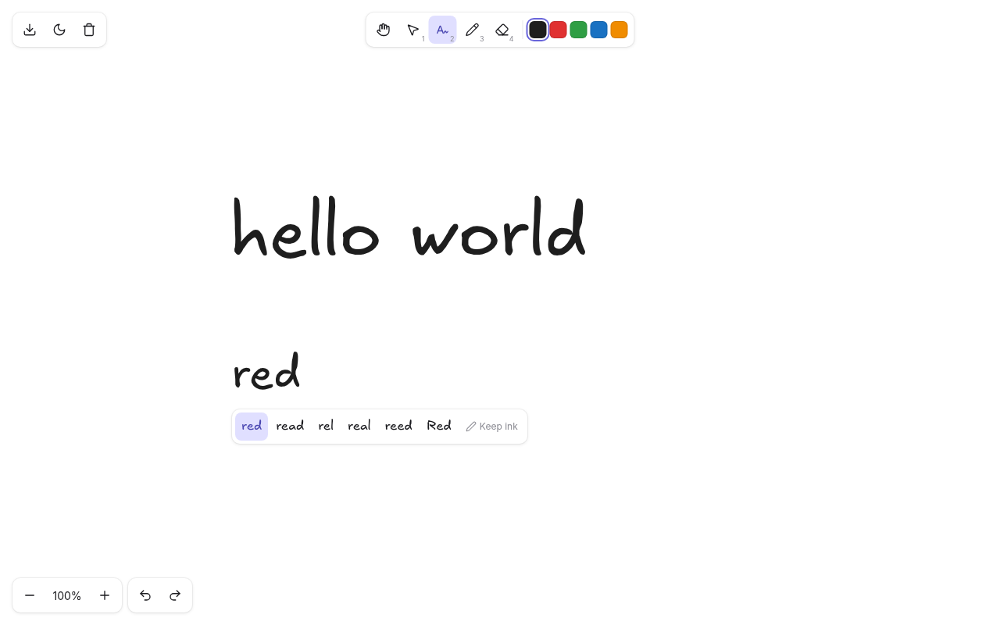

# Inkboard

A big blank whiteboard where mouse handwriting turns into clean text in
Excalifont, the hand-drawn font Excalidraw uses. Scribble a word, pause, and
it becomes text the same size and place as your writing; a bar underneath
offers other readings if it guessed wrong.



- Handwriting to text with a suggestion bar, or keep the ink as drawn
- Σ becomes a hand-drawn ∑, for sums in maths and physics
- Infinite board: pan, zoom, freehand drawing, hand-drawn arrows, eraser, 5 colors, 3 stroke widths
- Select, move and resize; draw a loop around things to select them all
- Paste text and it becomes Excalifont text; paste a picture and it goes on the board as-is
- Undo/redo, PNG export, dark mode, saves itself in the browser

It's plain HTML, CSS and JavaScript: no build step, no dependencies.

## Running it

Open `index.html` in Chrome or Chromium. For an app window of its own:

```sh
google-chrome-stable --app="file://$PWD/index.html"
```

The board is saved in the browser's localStorage, and pasted pictures in its IndexedDB
(they're too big for localStorage); both are per Chrome profile.
Opening it with a fixed `--profile-directory=Default` (or whichever profile you
like) keeps it on the same board every time.

## Using it

| Key | Tool |
| --- | --- |
| `W` / `2` | Write: scribble, pause, and it becomes text. Double-click to edit or add text, as in Select |
| `P` / `3` | Draw: freehand ink that stays ink |
| `V` / `1` | Select: drag, resize from the corner handles, `Delete`, double-click to edit or add text. Draw a loop around things on empty board to select them all; `Shift`+click or `Shift`+loop adds to the selection; `Ctrl+A` selects everything |
| `E` / `4` | Eraser |
| `A` / `5` | Arrow: drag from the tail to the tip; hold `Shift` to keep it to 15° steps |
| `H` or hold `Space` | Pan (the mouse wheel also pans, `Ctrl+wheel` zooms) |

- While writing, `Enter` converts right away and `Esc` keeps your handwriting.
- After a conversion, the bar under the text shows other readings. Click one to swap it, or click "Keep ink".
- Sums: draw Σ and it becomes a hand-drawn ∑, with the rest of the line read around it
  (`∑x`). One stroke or up to three (say, the top bar on its own), in any order or direction.
  If it was really an E or a 2, those readings are in the suggestion bar. And whenever a
  reading has an "E" in it, the bar offers the same reading with ∑ in place of the E,
  right after the best guess.
- The three line buttons after the colors set the stroke width (thin, medium, thick) for the pencil
  and arrows; with ink or arrows selected they change those too. An arrowhead grows with its line.
  Arrows are drawn a little sloppy, like Excalidraw's, and each keeps its own wobble when moved or copied.
- Arrows: select one and drag either end to move just that end (`Shift` snaps the angle again).
  Moving, resizing, colors, copy/paste and the eraser treat arrows like everything else.
- `Ctrl+V` pastes at the mouse. Text from anywhere becomes Excalifont text in the current
  color; a picture (a screenshot, "Copy image" in a browser) goes on the board unchanged, at its
  real size unless it wouldn't fit on screen. Either way it comes in selected, ready to move or resize.
  (Dark mode inverts the board, and pictures are inverted back, so they look a little muted there,
  as in Excalidraw.)
- `Ctrl+C` / `Ctrl+X` copy or cut the selection. Pasting it back on the board brings back the
  same ink, text and pictures; pasting it in another app gives the words of its texts.
- `Ctrl+Z` / `Ctrl+Shift+Z` undo and redo (undoing a conversion brings your ink back).
- `Ctrl+Shift+E` exports a PNG, and `Shift+Alt+D` toggles dark mode.

## How recognition works

Strokes are sent as timed point lists to Google's handwriting recognizer
(the one behind Google Input Tools and Translate's handwriting box). It reads
the pen movement rather than a picture, which is why it copes with mouse
scrawl. No dataset or model is needed, but it does need internet access, and
what you write in Write mode is sent to Google. Draw mode ink never leaves the
browser. When the recognizer can't be reached, your ink is kept as-is.

That recognizer has no math mode (it reads Σ as "E" or "2"), so `app.js` spots Σ
itself: runs of up to three consecutive strokes are joined end to end in every order and
direction, resampled, and compared to Σ templates (`SIGMA_THRESHOLD`). The pieces of the
line between sums are then read separately.

Change `LANG` at the top of `app.js` to recognize another language (`hi`, `de`, `fr`, ...).

## Files

| File | What it is |
| --- | --- |
| `index.html` | The page: canvas, toolbars, suggestion bar |
| `app.js` | Everything else: board, tools, arrows, recognition, Σ, copy/paste, undo, storage |
| `style.css` | Excalidraw-like toolbars, light and dark |
| `fonts.css` | Excalifont, embedded so the page works from `file://` |
| `icon.svg` | App icon (also the favicon) |

## Font

`fonts.css` embeds the Latin, Latin-extended and symbols (∑) subsets of Excalifont,
taken from `@excalidraw/excalidraw` 0.18.1. Excalifont is © 2024 Excalidraw and licensed
under the SIL Open Font License 1.1; see [`OFL-Excalifont.txt`](OFL-Excalifont.txt).
